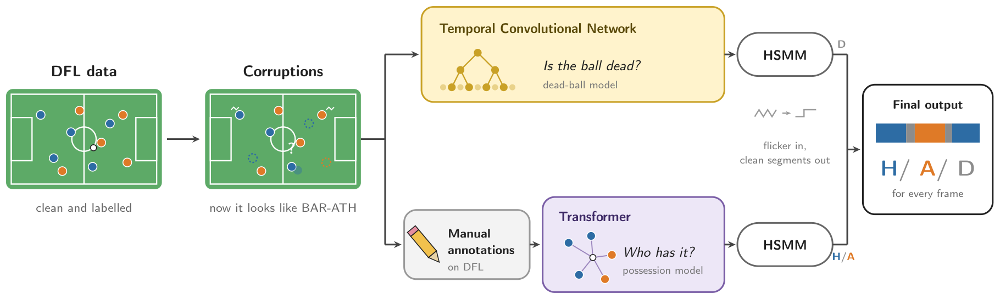
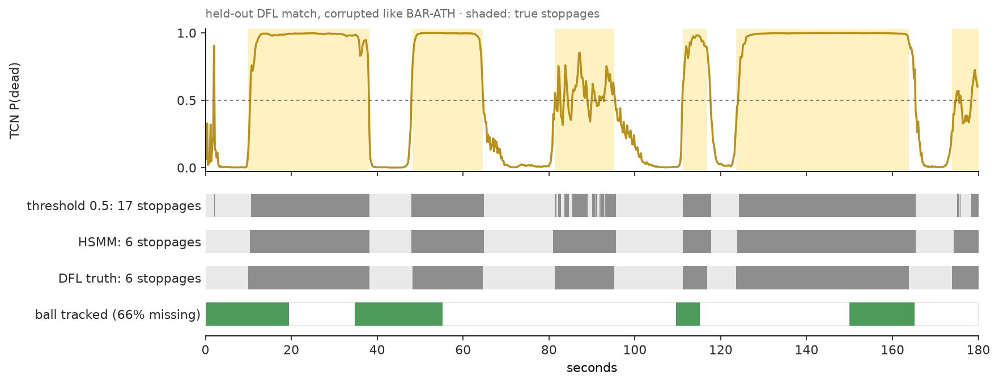

# Hacktrick — ball possession for More than a Hack 2027, Phase 1

For every frame of BAR-ATH, this repository says who has the ball: `H` (home), `A` (away) or `D`
(dead ball). It is team **Hacktrick**'s code submission, and this README is our technical document
(submitted as `Hacktrick.md`; the possession file as `Hacktrick.csv`). The challenge itself is
described by the organisers in [COMPETITION.md](COMPETITION.md), [CHALLENGE.md](CHALLENGE.md),
[RULES.md](RULES.md) and [SUBMISSION.md](SUBMISSION.md).

| Team member | GitHub |
|---|---|
| Xavi Pacheco | [@pokexavi](https://github.com/pokexavi) |
| Benet Ramió | [@benetraco](https://github.com/benetraco) |
| Valentin Micu-Hontan | [@valy3124](https://github.com/valy3124) |
| Álvaro Díaz | [@Alvaritox11](https://github.com/Alvaritox11) |

- [1. Summary](#1-summary)
- [2. Approach](#2-approach)
  - [2.1 Data and corruptions](#21-data-and-corruptions)
    - [2.1.1 Learned corruptions](#211-learned-corruptions)
    - [2.1.2 Other corruptions](#212-other-corruptions)
  - [2.2 Dead-ball model](#22-dead-ball-model)
  - [2.3 Possession model](#23-possession-model)
    - [2.3.1 Architecture](#231-architecture)
    - [2.3.2 Architecture formulation](#232-architecture-formulation)
  - [2.4 Integration](#24-integration)
  - [2.5 Training setup](#25-training-setup)
- [3. Assets: what we used, and what we tried and dropped](#3-assets-what-we-used-and-what-we-tried-and-dropped)
- [4. Training data](#4-training-data)
- [5. Results](#5-results)
  - [5.1 Dead-ball model](#51-dead-ball-model)
  - [5.2 Possession model](#52-possession-model)
  - [5.3 Full pipeline on the public GT](#53-full-pipeline-on-the-public-gt)
- [6. Limitations](#6-limitations)
- [7. Reproduction](#7-reproduction)
  - [7.1 Environment](#71-environment)
  - [7.2 Data](#72-data)
  - [7.3 From zero](#73-from-zero)
  - [7.4 From the trained weights](#74-from-the-trained-weights)
    - [7.4.1 Inference with the saved dead/live mask (no dead-ball model)](#741-inference-with-the-saved-deadlive-mask-no-dead-ball-model)
- [8. Looking at the output](#8-looking-at-the-output)
- [9. Repository layout](#9-repository-layout)
- [10. Credits](#10-credits)

---

## 1. Summary



1. **DFL data:** 7 public, labelled Bundesliga matches. BAR-ATH is only used to predict.
2. **Corruptions:** DFL is made to look like BAR-ATH's noisy tracking.
3. **Two models:** a TCN says whether the ball is dead ([dead_alive_detection/](dead_alive_detection/));
   a transformer, trained with our manual annotations, says who has it ([possession_model/](possession_model/)).
4. **HSMM:** turns each model's flickering output into whole stoppages and possessions.
5. **Final output:** `H`, `A` or `D` for every frame.

---

## 2. Approach

This section is divided into five parts: the data and corruptions shared by both models
(dead-ball model, possession model), the dead-ball model, the possession model, the integration of
both into the final output, and how both are trained and validated.

### 2.1 Data and corruptions

**Data.** Both models learn only from the 7 public Sportec Open DFL matches. DFL and BAR-ATH are
converted to the same format ([external/schema.py](external/schema.py)).

**Corruptions.** This is the key to the whole approach. DFL's tracking is nearly perfect; BAR-ATH's
automatic tracker loses the ball on 41% of the frames, drops players and swaps them between slots,
and its ball keeps moving during stoppages. A model trained on clean DFL would meet inputs on
BAR-ATH it has never seen (a distribution shift between training and test). So we corrupt every DFL
training match to look like BAR-ATH. How BAR-ATH's tracker fails is taken from BAR-ATH itself,
never from its labels: some corruptions are learned on it, one reuses pieces of it, two are rules.

Used by: 🟨 dead-ball model · 🟪 possession model

#### 2.1.1 Learned corruptions

- **Players lost** 🟨🟪 *(learned on BAR-ATH)*. Players vanish and come back where BAR-ATH loses
  them (more in crowds and when the players slow down, as in dead time). Each piece of track goes
  into a random anonymous slot, with some duplicated players, as on BAR-ATH.
- **Ball hidden** 🟨🟪 *(learned on BAR-ATH)*. The ball disappears in the same situations as on
  BAR-ATH (often when play stops).

**How they work.** At every step (0.2 s), the ball, or a player, is either *visible* or *lost*.
Two small models give the chance of switching:

- **lose:** visible now, lost at the next step;
- **find:** lost now, visible again at the next step.

$$P(\text{lost}_{t+1}\mid\text{visible}_t)=\sigma(\mathbf{w}_{\text{lose}}^{\top}\mathbf{x}_t+b_{\text{lose}}),\qquad P(\text{visible}_{t+1}\mid\text{lost}_t)=\sigma(\mathbf{w}_{\text{find}}^{\top}\mathbf{x}_t+b_{\text{find}})$$

$\mathbf x_t$ describes the situation at that step (table below). So the ball and the players
disappear more in the situations where BAR-ATH's tracker loses them.

*What they learn from.* Only BAR-ATH's tracking, with no human labels (self-supervised): whether
the tracker sees something is the answer the models learn to predict.

- **Ball.** At each step the ball is either tracked or not. Visible, then missing at the
  next step, is a *lose*; missing, then back, is a *find*.
- **Players.** On BAR-ATH a slot is not always the same person. We first rebuild
  each player's track: a slot that jumps more than 4 m in one step has changed person,
  so it is cut there. A track that ends is a *lose*. A new track of the same team that starts
  close enough to have been reached on foot (within 60 s) is the same player found again: a
  *find*.

*Model.* Each of the four models (lose and find, for the ball and for the players) is a logistic
regression, trained with the usual log-loss plus an L2 penalty:

$$\mathcal{L}(\mathbf{w},b)=-\sum_i\Big[y_i\log p_i+(1-y_i)\log(1-p_i)\Big]+\tfrac{1}{2}\lVert\mathbf{w}\rVert^2,\qquad p_i=\sigma(\mathbf{w}^{\top}\mathbf{x}_i+b)$$

*What they look at* ($\mathbf x_t$). While something is lost, it is described by where it was
last seen.

| | lose | find |
|---|---|---|
| **Ball** | its speed; distance to the lines, and whether it is out; players within 3 m | time since last seen; the same distances |
| **Players** | own speed; time visible; players around; distance to the lines and to the team | time lost; the same place features |
| **Both** | how fast the players move, and whether they slow down or speed up over the 3–10 s before and after | the same |

*Using them on DFL.* The chain runs on every DFL match, step by step, with random draws. The models
decide *where* the ball and the players disappear; *how much* is a setting:

- **Ball:** each training copy hides it on a different share of the frames, from 0 to 100% (see in 2.5),
  so the model does not rely on one rate. The DFL matches we test on use 41%, BAR-ATH's rate.
- **Players:** the chance of a lost player coming back (*find*) is scaled, for each team, until
  the DFL copy tracks on average as many players as BAR-ATH does.

Both rates are counts of what BAR-ATH's tracker sees, not labels.

#### 2.1.2 Other corruptions

- **Dead ball moving** 🟨 *(pieces of BAR-ATH)*. DFL freezes the ball during stoppages, BAR-ATH
  never does, so a model would learn "still ball = dead ball". We fill each DFL stoppage with the
  **motion** (frame-to-frame displacement, not positions or players) of BAR-ATH's ball in dead
  time, starting where DFL froze it and ending where play restarts. The pieces are drawn at random
  from BAR-ATH stretches that 2 of 3 earlier dead-ball models (trained on DFL, without this
  corruption) call dead: pseudo-labels made by algorithms, no human labels.
- **Referee whistles** 🟨 *(rules)*. The dead-ball model reads a whistle flag: 1 on the steps where
  a whistle sounds, 0 elsewhere. On BAR-ATH it comes from an audio detector (2.2), which misses
  many whistles and sometimes fires on crowd noise. DFL has no audio, but its event data gives the
  type of every stoppage, so the flag is simulated on each training copy in two steps:
  1. **True whistles.** Each real DFL stoppage gets a whistle where the referee would blow, with a
     probability that depends on its type, following the Laws of the Game: at its start, 0.95 for
     a foul and 0.05 for a throw-in, goal kick or corner; before the restart, 1 for the kickoff
     after a goal.
  2. **Detector errors injected on purpose.** As on BAR-ATH, the flag must not be trusted
     blindly. Each true whistle is then kept with probability $r$ (the others are deleted, as
     missed whistles), and **false whistles** (the detector firing on the crowd or the
     commentary) are added at uniformly random times, at $\lambda$ per minute.
     $r$ and $\lambda$ are drawn once per training copy, $r$ between 0.1 and 0.8 and $\lambda$
     between 0 and 0.25, so some copies have a reliable flag and others an unreliable one.

  The probabilities follow the football Laws of the Game (when the referee must whistle). To make
  the simulated flag on DFL look like the detector's output on BAR-ATH, two details are taken from
  algorithms run on BAR-ATH, with no labels: each simulated whistle on DFL is as long as one our
  audio detector found on BAR-ATH, and it is placed about 0.2 s before the DFL stoppage starts.

- **Keeper holds** 🟨 *(rules)*. A tracker often loses the ball while a goalkeeper holds it (in
  the hands, against the body), and a model then reads the gap as a stoppage. A *keeper hold* is
  found by an algorithm on clean DFL tracking: live play, ball inside the penalty area within 2 m
  of its keeper for at least 1.5 s.
  Each hold is hidden at random with probability 0.8, from just after it starts until up to 6 s
  after it ends, so the model learns that this is still live play. Only DFL data is used. The
  values are fixed in advance from general football knowledge (how long a keeper usually holds the
  ball before playing it) and apply the same way to every hold.


### 2.2 Dead-ball model

For every frame, the dead-ball model says whether the ball is in play. It works in three stages:
features per step, a TCN that gives P(dead) per step, and an HSMM that turns it into whole
stoppages ([dead_alive_detection/](dead_alive_detection/)).

**Features.** The tracking is resampled at 5 Hz (one step = 5 frames) and each step gets 37
features, computed the same way on DFL and BAR-ATH. They are never raw coordinates: we use
distances to the lines and spots, since a corner is the same at all four flags. Counts are
fractions of the tracked players, because BAR-ATH tracks fewer. Player speeds above 10 m/s or
accelerations above 10 m/s² (identity swaps) are left out.

| group | n | examples | what it catches |
|---|:-:|---|---|
| players | 8 | mean speed, share walking, team spreads, gap between team centroids, share in a box / near a touchline | the collective stop, set-piece shapes |
| collective stop | 8 | 90th-percentile speed, sudden drop, restart burst, seconds stopped | the whistle and the restart |
| ball | 12 | seen or not, seconds since / until seen, distance to lines, corners and centre spot, speed, seconds still, nearest player | a ball out, a still ball waiting |
| last-seen ball | 2 | distance to the line where it was lost, its speed towards it | the ball lost as it goes out |
| goalkeeper | 4 | the keeper's distance to the last-seen ball, speed and distance to goal | a catch (live) against a goal kick (dead) |
| tracked players | 2 | players tracked per team | BAR-ATH loses players in crowds, mostly in dead time |
| whistle | 1 | a referee whistle on this step | fouls, offsides |

On BAR-ATH, the whistle comes from our detector on the broadcast audio
([dead_alive_detection/audio/whistle.py](dead_alive_detection/audio/whistle.py)). It is classical signal
processing, with no learning: it looks for a loud, nearly pure tone in the 3.2–4.1 kHz band, where
the referee's whistle sits (~3.8 kHz). Its thresholds were set without labels, where these tones
gather at our model's predicted stoppage starts. On DFL the whistle is simulated (2.1).

**TCN.** A temporal convolutional network with 8 residual blocks of two dilated convolutions
(kernel 3, 64 channels, dilations 1, 2, …, 128). It is non-causal: each step sees about ±100 s
before and after. It has three outputs per step: P(dead), P(a stoppage starts here) and P(it ends
here). During training it also predicts the stoppage type (throw-in, corner, foul…) as a small
auxiliary loss. It is trained on 2-minute windows for 40 epochs with AdamW and no early stopping.

**HSMM decoder.** P(dead) flickers: on the held-out matches of the 6 validation folds (2.5),
corrupted like BAR-ATH, a 0.5 threshold gives 914 stoppages where there are 615. A plain HMM does
not fix this: with a constant switching probability, the most likely length of any segment is one
step. Our hidden semi-Markov model scores whole segments
instead:

$$\text{score}(\text{segment}) = \log P(\text{duration}\mid\text{state}) + \tau\sum_{t\in\text{segment}}\text{evidence}_t$$

- **Duration prior:** learned from DFL's labels, as a density over the log-duration. Throw-ins,
  corners and goals have different typical lengths, which gives several bumps.
- **Evidence:** the TCN's log-odds of dead, plus a bonus from the start and end outputs at each
  segment's edges.

Viterbi finds the best alternating sequence of live and dead segments (594 stoppages on the same
matches). τ = 0.25 and the two edge weights (0.5 at the start, 2.0 at the end) were chosen with a
grid over the folds.



*Three minutes of a held-out DFL match, corrupted like BAR-ATH. Where P(dead) hesitates (around
80–95 s), a threshold breaks one stoppage into many; the HSMM keeps it whole. The model keeps
working while the ball is missing.*

**Smart Tagging post-step (BAR-ATH only).** A set-piece tag (not a kickoff) with no predicted
stoppage inside it is taken as a stoppage the HSMM missed. A stoppage just outside the tag (within
2 s) still counts as inside it, in case the tag's timing is slightly off. The tag already says that
play stopped, so the TCN only has to say where: every rise of P(dead) above 0.05 that overlaps the
tag becomes dead. Without a dead ball P(dead) is usually close to 0, so even a small rise may mean
something. The rule cannot be scored on DFL, which has no Smart
Tagging.

**The final model on BAR-ATH.** Every number above comes from validation, where each model trains
on 5 DFL matches and is scored on a 6th (see in 2.5). Once the recipe was fixed, it was trained again on
all 7 DFL matches, with 3 seeds. Their P(dead) are averaged, decoded by the HSMM and passed through the Smart Tagging post-step.

### 2.3 Possession model

The possession model assigns every live frame of the match to the team in possession, home (`H`)
or away (`A`). It does not decide whether the ball is in play: that is the dead-ball model's task
(see in 2.2), and its dead/live mask is taken as given. The final label of a frame is therefore `D` where
the dead-ball model says the ball is out of play, and the possession model's `H` or `A` elsewhere.

The model reads two inputs:

- **The tracking** of the players and the ball, reduced to 5 snapshots per second (a snapshot is
  the position of every player and of the ball at one instant). On BAR-ATH a tracking slot can
  change from one player to another, so the model never assumes that a slot is always the same
  person.
- **The dead/live mask**, which says at every snapshot whether the ball is in play. The model
  only predicts possession on live snapshots, but it still sees the dead snapshots before and
  after them, marked as dead. This matters at restarts: how the players line up during a stoppage shows which
  team will take the throw-in, free kick or corner. In training, the mask comes from DFL's own
  labels. On BAR-ATH, it comes from the dead-ball model.

The prediction is made in two stages:

1. **A neural network (2.3.1)** reads 30 s windows of tracking and returns, for every snapshot,
   the probability that the home team has the ball and the probability that possession changes at
   that snapshot.
2. **An HSMM decoder (2.3.1, part 4)** turns these per-snapshot probabilities into whole possessions. Each
   live stretch between two stoppages is decoded on its own, with priors on how long possessions
   last counted on the training matches.

The network is trained on the DFL matches (see in 2.5), corrupted with some of the tracking losses as in the
dead-ball model (players lost and ball hidden, see in 2.1.1), and its target is DFL's possession labels
after our relabelling (section 4).

#### 2.3.1 Architecture


**1. Input tokens**

Each snapshot of the tracking (5 per second) is described as a set of tokens,
each a vector of features:

- one **context token**, which describes the snapshot as a whole;
- one **ball token**;
- one **player token** per tracked player, up to 16 per team. Empty slots are masked out.

**Why a set of tokens.** The natural alternative, a fixed vector with one entry per tracking slot,
does not suit BAR-ATH. Its slots are anonymous: a slot can pass from one player to another, the
number of tracked players changes all the time, and a team sometimes has more than eleven slots
filled (a player tracked twice). A set has no order and no fixed size, so the model never relies on
slot $k$ being a particular player, and it handles any number of players in the same way. For the
same reason, no feature identifies a player: a player token only says where someone of a given team
is and how they move.

The features of each token, grouped by what they describe:

| token | group | features | why |
|---|---|---|---|
| **Player** | position | $x, y$; distance to each goal | where the player is, and whether the team's shape is attacking or defending |
| | motion | velocity $(v_x, v_y)$, acceleration $(a_x, a_y)$, speed; a flag for unreliable velocity | who runs to the ball, who presses, who sprints into space after winning it |
| | team | home or away | which side the player is on |
| | ball | offset to the ball $(\Delta x, \Delta y)$ and distance to it; a flag for a ball not seen | the player closest to the ball is usually the one in possession |
| **Ball** | position | $x, y$; distance to each goal | where the ball is on the pitch |
| | motion | velocity $(v_x, v_y)$ | how the ball moves: a long pass is fast, a dribble slow |
| | visibility | seen or not; seconds since last seen; last seen position; a flag for "not seen yet in this half" | BAR-ATH loses the ball 41% of the time: the model must know when, and a recent last position is still informative |
| **Context** | dead/live | whether the snapshot is live; seconds since the live stretch started and until it ends | right after a restart, the restarting team has the ball |
| | tracking | number of tracked players of each team | on BAR-ATH this number varies a lot, so the model should not read "few players" as "no possession" |

Each kind of token has its own linear projection to a common width ($d = 64$), plus a learned
embedding of its kind (context, ball or player), so that the encoder can tell them apart.

**2. Team views, set encoder and temporal transformer**

The tokens of part 1 go through three
stages.

**Team views.** Every snapshot is read twice by the same network. The **home view** is the snapshot as
it is. The **away view** is the same snapshot with the pitch turned 180° and the two teams swapped,
so that the away team is now the one attacking $+x$ and is marked as "home". Both views are
processed separately, with the same weights, and the possession output is their difference (part 3).
Two properties follow. First, swapping the teams of a match swaps the answer exactly, so the model
cannot learn a bias such as "the home team has the ball more often". Second, every training snapshot
teaches the network about possession from both teams' point of view.

**Set encoder.** Within one snapshot, the tokens exchange information through attention: each token
looks at the others and updates its own vector. This is how the model reads the relations that
decide possession: which player is closest to the ball, who is pressing him, where his team-mates
are. Of the 4 attention heads, 2 are biased towards nearby tokens, so they focus on the local duel
around the ball; the other 2 look at every token, to capture the shape of both teams. Attention does
not depend on the order or the number of tokens, which is what a set of anonymous players needs.
After the encoder, the context token summarises the whole snapshot in a single vector.

**Temporal transformer.** A single snapshot is often ambiguous: the ball may be loose, in the air or
not seen at all. What happens in the seconds before and after usually says who really controls it.
The temporal transformer therefore reads the sequence of snapshot vectors over a 30 s window (150
snapshots), in both directions. Attention fades with the time between two snapshots, faster in some
heads than in others, so some heads focus on the immediate surroundings and others on the whole
window. Dead snapshots stay in the window, as explained above. At inference, a half is covered by
windows that overlap by half their length, and the outputs on the overlaps are averaged.

**3. Heads and loss**

Two small output layers, or heads, read the vector of each snapshot. Both
are needed by the HSMM decoder (part 4), and each answers a different question.

- **Possession head: who has the ball?** It gives, for every snapshot, the probability that the
  home team is in possession. It is computed from the two team views: the same head scores the
  home view and the away view, and the probability comes from the difference of the two scores.
  As a result, swapping the teams swaps the answer exactly, and the network has no built-in
  preference for either team.
- **Change head: does possession change here?** It gives, for every snapshot, the probability that
  a change of possession happens at that moment. The possession head alone says *who* has the
  ball, but it moves gradually from one team to the other, so it does not say precisely *when*
  the ball changed hands. The change head gives the decoder that information, so that possessions
  start and end at the right moment. A change is the same event from both teams' point of view,
  so this head averages the two views instead of subtracting them.

The network is trained with one loss per head, both binary cross-entropies, computed only on live
snapshots. The possession loss compares the possession head with the label of the snapshot (home
or away). The change loss compares the change head with a soft target: 1 exactly at a change of
possession, decreasing smoothly to 0 within about one second on each side. A soft target is used
because the exact frame of a change is uncertain, even in the labels, and a hard target would
punish a prediction one frame off as much as one far away. The change loss has half the weight
of the possession loss.

**4. HSMM decoder**

The per-snapshot probabilities still flicker, so they are turned into whole
possessions by an HSMM, as in the dead-ball model (2.2). It is a **separate HSMM**, with the same
algorithm but its own states and priors: its two states are home and away possession instead of
live and dead, and the possession lengths it expects are counted on the possession labels of the
training matches. It runs on each live stretch on its own, since a possession never spans a
stoppage. The possession head gives the evidence for each state, and the change head tells it
where one possession is likely to end and the next to begin.

The HSMM is not part of training: the network's loss never sees it, and its priors are counted,
not learned. It is applied whenever the network's output is turned into possessions, both to score
the held-out DFL matches and to predict BAR-ATH.

#### 2.3.2 Architecture formulation

This subsection states the network of 2.3.1 formally, part by part, with one notation
throughout.

**Input tokens**

At snapshot $t$, the model receives:

- the context features, $\mathbf c_t \in \mathbb R^{5}$;
- the ball features, $\mathbf b_t \in \mathbb R^{11}$;
- the features of each tracked player, $\mathbf p_{t,i} \in \mathbb R^{15}$ for $i = 1, \dots, N_t$.

Here $N_t$ is the number of players tracked at snapshot $t$, both teams together. It changes from
one snapshot to the next, and is at most 32 (16 per team). Each of these vectors is projected
to $\mathbb R^{d}$, which gives the $N_t + 2$ inputs of the encoder (one context, one ball, and $N_t$
players):

$$\mathbf{x}_{t,0} = \mathbf{W}_c \mathbf{c}_t + \mathbf{e}_c, \qquad \mathbf{x}_{t,1} = \mathbf{W}_b \mathbf{b}_t + \mathbf{e}_b, \qquad \mathbf{x}_{t,1+i} = \mathbf{W}_p \mathbf{p}_{t,i} + \mathbf{e}_p \quad (i = 1, \dots, N_t)$$

Here the matrices $\mathbf W_c$, $\mathbf W_b$ and $\mathbf W_p$ are the learned projections
(with bias) to $\mathbb R^{d}$, and the vectors $\mathbf e_c$, $\mathbf e_b$ and $\mathbf e_p$
are the learned embeddings of each kind. The same $\mathbf W_p$ and $\mathbf e_p$ are shared by
every player of both teams: a player token differs from another only by its features.

**Team views**

Let $v \in \lbrace \mathrm{H}, \mathrm{A} \rbrace$ denote the view. In the away view,
where $v = \mathrm{A}$, every coordinate, velocity, acceleration and ball offset of the features
of part 1 changes sign, the distances to the two goals are swapped, the team flag of each player
is inverted, and the counts of tracked players of the two teams are swapped. The resulting inputs
are written $\mathbf x_{t,j}^{v}$, with $j = 0$ the context token, $j = 1$ the ball token, and
the player tokens at $j = 2, \dots, N_t + 1$.

**Set encoder**

The encoder applies $L = 2$ transformer blocks to the $N_t + 2$ inputs of each
snapshot. Let the matrix $\mathbf X \in \mathbb R^{(N_t + 2) \times d}$ stack these vectors, one
row per token. Each block updates it in two residual steps, each preceded by a layer
normalisation:

$$\mathbf{X} \leftarrow \mathbf{X} + \mathrm{MHA}\left(\mathrm{LN}(\mathbf{X})\right), \qquad \mathbf{X} \leftarrow \mathbf{X} + \mathrm{FFN}\left(\mathrm{LN}(\mathbf{X})\right)$$

where the feed-forward network $\mathrm{FFN}$ is two linear layers with a GELU between them (inner
width $2d$), applied to each token on its own. The multi-head attention $\mathrm{MHA}$ is where the
tokens exchange information. It has 4 heads, each working in a space of size $d_h = d/4 = 16$.
With the normalised input $\mathbf{Y} = \mathrm{LN}(\mathbf{X})$, head $h$ builds three matrices
from it with its own learned weights in $\mathbb{R}^{d \times d_h}$, and the 4 heads are
concatenated and projected back to width $d$ by a learned matrix $\mathbf{W}_{O}$:

$$\mathbf{Q}^{h} = \mathbf{Y}\mathbf{W}_{Q}^{h}, \quad \mathbf{K}^{h} = \mathbf{Y}\mathbf{W}_{K}^{h}, \quad \mathbf{V}^{h} = \mathbf{Y}\mathbf{W}_{V}^{h}, \qquad \mathrm{head}_h = \mathrm{softmax}\left(\frac{\mathbf{Q}^{h}(\mathbf{K}^{h})^{\top}}{\sqrt{d_h}} + \mathbf{B}^{h}\right)\mathbf{V}^{h}, \qquad \mathrm{MHA}(\mathbf{Y}) = \left[\mathrm{head}_1, \dots, \mathrm{head}_4\right]\mathbf{W}_{O}$$

Each row of the queries $\mathbf{Q}^{h}$ says what a token is looking for, each row of the keys
$\mathbf{K}^{h}$ what a token offers to be found by, and each row of the values $\mathbf{V}^{h}$
the information it passes on. The softmax is taken over each row: row $j$ gives the weights with
which token $j$ averages the values of all the tokens.

The matrix $\mathbf B^{h}$ is a bias between every pair of tokens $j$ and $k$. For the 2 global
heads the bias is 0. For the 2 distance heads it penalises the distance between the two tokens:

$$B_{jk}^{h} = -\lambda_h \thinspace \frac{\lVert \mathbf{r}_j - \mathbf{r}_k \rVert}{10\thinspace\mathrm{m}}$$

Here $\mathbf r_j$ is the position on the pitch of token $j$ (a player, or the ball when it is
seen), and $\lambda_h > 0$ is a learned rate for each distance head. When a token has no position
(the context token, or a ball not seen), the bias is 0. Empty player slots are masked
out ($B_{jk}^{h} = -\infty$). The output of the encoder for snapshot $t$ is the final vector of the
context token:

$$\mathbf{z}_t^{v} = \mathrm{LayerNorm}\left(\mathbf{x}_{t,0}^{v,(L)}\right) \in \mathbb{R}^{d}$$

**Temporal transformer**

For a window of $T = 150$ snapshots, the encoder outputs of the window,
from $\mathbf z_1^{v}$ to $\mathbf z_T^{v}$, go through 2 more transformer blocks of the same form
as in the set encoder: the rows of $\mathbf X$ are now the $T$ snapshots of the window instead of
the tokens of one snapshot. Its 4 heads use a bias that depends only on the time between two
snapshots (ALiBi):

$$B_{ts}^{h} = -m_h \thinspace  \lvert t - s \rvert, \qquad m_h = 2^{-2(h+1)}, \quad h = 0, \dots, 3$$

The slopes $m_h = 1/4, 1/16, 1/64, 1/256$ per snapshot make the attention of the first head fade
within a few seconds and that of the last one span the whole window. The output is one vector per
snapshot and per view, $\mathbf h_t^{v} \in \mathbb R^{d}$ for $t = 1, \dots, T$.

**Heads and loss**

Both heads are linear layers applied to the output of the temporal
transformer, separately for each view $v$. The possession head has weights $\mathbf w_p$ and bias
$b_p$, and the change head has weights $\mathbf w_c$ and bias $b_c$. For each view they give a
score. The possession logit is the difference between the home and the away scores, and the
change logit is their average. With $\sigma$ the sigmoid:

$$s^{v}_{t} = \mathbf{w}_{p}^{\top}\mathbf{h}^{v}_{t} + b_{p}, \qquad \ell_{t} = s^{\mathrm{H}}_{t} - s^{\mathrm{A}}_{t}, \qquad P(\text{home has the ball at } t) = \sigma(\ell_{t})$$

$$g^{v}_{t} = \mathbf{w}_{c}^{\top}\mathbf{h}^{v}_{t} + b_{c}, \qquad \kappa_{t} = \tfrac{1}{2}\left(g^{\mathrm{H}}_{t} + g^{\mathrm{A}}_{t}\right), \qquad P(\text{possession changes at } t) = \sigma(\kappa_{t})$$

In the difference the bias $b_p$ cancels out, so the possession head cannot favour the home team.
Swapping the teams exchanges the two views: the possession logit becomes its opposite, so the
probability that the home team has the ball becomes the probability that the away team has it,
while the change logit stays the same.

The targets come from the labels. For a live snapshot $t$, the possession target is $y_t = 1$
if the home team has the ball and $y_t = 0$ if the away team has it. For the change target, let the
time $\Delta_t$ be the seconds between snapshot $t$ and the closest change of possession, that
is, the closest frame where the label switches between home and away during live play. The target
is a Gaussian bump around each change, with $\sigma_c = 0.4$ s. The change target, the binary
cross-entropy and the loss of a batch are:

$$c_t = \exp\left(-\frac{\Delta_t^{2}}{2\sigma_c^{2}}\right), \qquad \mathrm{BCE}(p, y) = -\left[y \cdot \log(p) + (1 - y) \cdot \log(1 - p)\right]$$

$$\mathcal{L} = \frac{1}{\lvert S \rvert}\sum_{t \in S} \mathrm{BCE}\left(\sigma(\ell_t), y_t\right) + \lambda \thinspace \frac{1}{\lvert S \rvert}\sum_{t \in S} \mathrm{BCE}\left(\sigma(\kappa_t), c_t\right), \qquad \lambda = 0.5$$

where the set $S$ holds the live snapshots of the batch that have a label. Dead snapshots, and
the padding at the edges of a window, are seen by the network but do not enter the loss.

### 2.4 Integration

On BAR-ATH the two models run one after the other, because the possession model needs the output
of the dead-ball model:

1. **Dead-ball model (2.2).** It reads the tracking, the referee whistles found in the broadcast
   audio and the Smart Tagging, and returns a dead/live mask for every frame of the match.
2. **Possession model (2.3).** It reads the tracking and that mask. It predicts home or away only
   on the live frames, and decodes each live stretch between two stoppages on its own. The dead
   frames are still part of its input, so it can see how each restart is set up.
3. **Submission.** The two outputs are merged frame by frame: `D` wherever the dead-ball model says
   the ball is out of play, and the possession model's `H` or `A` everywhere else. The second half
   counts as dead until its kickoff. The file is then checked with the organisers' validator.

The order matters. Every error of the dead-ball model reaches the final file: a missed stoppage
can join two possessions into one, and a false stoppage marks live frames as `D` and splits a
possession in two.

### 2.5 Training setup

**Validation.** Of the 7 DFL matches, 1 (`J03WR9`) is kept apart as the test match and never used
for any decision. The other 6 are the development matches, used leave-one-match-out: 6 folds, and
in each fold a model trains on 5 matches and is scored on the 6th (the held-out match), which it
has never seen. Every choice was made on the mean score over these 6 folds. The final dead-ball
model is retrained on all 7 matches, including the test match (2.2).

**Corrupted copies (data augmentation).** Inside each fold, the 5 training matches and the
held-out match are corrupted differently:

```
one fold                                                  ball hidden on
  training   match A ─► A₁  A₂  A₃  A₄  A₅  A₆             0  25  41  60  80  100 % of the frames
             match B ─► B₁  B₂  B₃  B₄  B₅  B₆
             ...  (5 matches × 6 copies = 30 corrupted matches to train on)
  held-out   match F ─► F (one copy)                       41 %, as on BAR-ATH  → scored
```

- **Why 6 copies of each training match?** The copies differ in how much of the match the ball
  is missing, from never (0%) to always (100%). The model then learns to work with any amount of
  ball, and not to depend on it: on BAR-ATH it is missing 41% of the time, for stretches of up to
  tens of seconds. Each copy is also a different random draw of everything else (which players are
  lost and when, the dead-ball pieces, the whistles), so the 6 copies are 6 different corrupted
  versions of the same match.
- **The copies are fixed.** They are built once, before training, and are not redrawn between
  epochs. What changes between epochs is which copies the model reads:
  - 🟨 dead-ball model: each epoch reads **one** copy of every training match, chosen at random
    (epoch 1 may read A₃, epoch 2 A₆, ...).
  - 🟪 possession model: there is no copy per epoch; every batch mixes 30 s windows taken from any
    of the 30 copies.
- **The held-out match is corrupted once**, with BAR-ATH's 41% of hidden ball, and its score is the
  fold's score. It is also scored clean for reference.

---

## 3. Assets: what we used, and what we tried and dropped

**The dead-ball model** reads:

- **tactical ATD tracking** (players and ball) + its metadata: converted to metres with home
  attacking +x ([external/convert_atd.py](external/convert_atd.py))
- **broadcast video, audio track only**: the referee-whistle detector, an input on BAR-ATH
- **tactical Smart Tagging**: the post-step: set pieces with no predicted stoppage

**The possession model** reads:

- **the same tactical ATD tracking**: its only input, as a token per player and one for the ball
- **the dead/live mask** of the dead-ball model: as a context flag, so the set-up of a restart
  informs who restarts

Not used by either model: the tactical video (only the review app, section 8), the homography and
broadcast ATD, and the public 5-minute ground truth, used as a pipeline check only (format, frame
alignment, team mapping); `convert_atd.py` stores it as the label column of the processed match and
no model reads it.

From BAR-ATH's own tracking we fitted, without any labels: the ball-loss model, the player-loss
model, the dead-ball motion library (stretches that 2 of 3 models call dead) and the tracking-noise
aggregates. These are the "learning without human labels" that RULES.md allows.

**Tried and dropped** (the code is not part of this repository):

| idea | outcome |
|---|---|
| [PathCRF](https://github.com/hyunsungkim-ds/pathcrf) (Kim et al., KDD 2026), a pretrained ball-free possession model, with output smoothers (incl. one on its CRF marginals) | our first possession pipeline; replaced by our own model, trained on labels relabelled to the challenge's definition of possession |
| [T-DEED](https://github.com/arturxe2/t-deed) (Xarles et al., CVPRW 2024), action spotting on the broadcast video (SoccerNet), to catch the hard stoppages the tracking misses, such as fouls and offsides | did not work well: it agreed with the tracking-only dead-ball model on ≥98.9% of the frames, and most of its extra detections were false positives |
| recovering the lost ball from the tactical video (YOLO11s + re-scorer + Viterbi) | moved BAR-ATH's dead-ball output less than a change of seed: the lost ball is mostly not visible on the video either |
| dead-ball decoder rules: minimum alive duration, merging short alive gaps, Smart Tagging as decoder evidence | 0/6 DFL folds better, or slightly negative |

---

## 4. Training data

**None of it comes from BAR-ATH.**

- **Sportec Open DFL** — 7 matches of corrected tracking at 25 fps, about a million frames, labelled
  by DFL / Sportec Solutions: Bassek et al. (2025), CC-BY 4.0, downloaded by
  [external/fetch_dfl.py](external/fetch_dfl.py). We use its per-frame `BallStatus` and
  `BallPossession` and its event feed.

- **Our relabelling of DFL possession** — DFL's `BallPossession` flips on every touch, so one team
  member (Xavi) reviewed all 7 matches in the labelling app in
  [possession_exploration/](possession_exploration/), looking only at its short possessions: when a
  change was clearly forced (a touch or a deflection without control) it was merged into the
  surrounding possession, and when in doubt it was left as DFL marks it. 176 edits
  over 4,272 frames (2.8 min) and 116 reviewed transitions (96 confirmed, 20 corrected), committed as
  [possession_exploration/labels/pokexavi.jsonl](possession_exploration/labels/pokexavi.jsonl).

The possession model's training target and DFL evaluation reference are DFL's labels with those
edits applied, then `external/labels.controlled(min_frames=25)`: a possession shorter than 1 s
between two of the other team is merged into the surrounding one, except reviewed transitions. The
dead-ball model uses DFL's `BallStatus` unchanged.

---

## 5. Results

### 5.1 Dead-ball model

> [!IMPORTANT]
> There is no usable ground truth for dead balls on BAR-ATH: the public 5 minutes hold only 4
> stoppages, and the full-match labels are private. We score against DFL's `BallStatus` instead,
> the official dead/live labels of the DFL test match. spellF1 and Macro F1 are computed with
> DFL's **true H/A**, so only the dead-ball mask varies: the numbers measure the dead-ball model
> alone.

**Setup.** We evaluate on the DFL test match **DFL-MAT-J03WR9**. Every model here is trained on
the 6 development matches only (seed 0), so none has seen it. We test in two conditions:

- **Clean:** the original DFL tracking.
- **Corrupted:** the same match with the final model's corruptions at BAR-ATH's settings (2.1):
  players lost as on BAR-ATH, ball hidden 43% of the time, BAR-ATH's dead-ball motion, simulated
  whistles and keeper holds.

**Models compared:**

- **Ours (tcn_bar_keeperhold) 🏆:** the final dead-ball model's recipe: TCN trained on the
  corrupted data, decoded by the HSMM.
- **Ours, threshold instead of HSMM:** the same P(dead), cut at 0.5.
- **Ours, trained without corruptions:** the same model, with the same labels, epochs and seed,
  but trained on clean DFL.

| Condition | Model | spellF1 | Macro F1 | Stoppages (pred / true) |
|---|---|:---:|:---:|:---:|
| Clean | 🏆 **Ours** | **0.932** | 0.990 | 89 / 92 |
| Clean | Ours, threshold instead of HSMM | 0.901 | 0.987 | 112 / 92 |
| Clean | Ours, trained without corruptions | 0.929 | **0.996** | 91 / 92 |
| Corrupted | 🏆 **Ours** | **0.921** | **0.972** | 91 / 92 |
| Corrupted | Ours, threshold instead of HSMM | 0.870 | 0.971 | 127 / 92 |
| Corrupted | Ours, trained without corruptions | 0.622 | 0.689 | 98 / 92 |

**Analysis.**

- **The corruptions are what make the model work on BAR-ATH-like tracking.** On clean input both
  models are almost equal (0.932 vs 0.929). On corrupted input, the model trained on clean DFL
  collapses (0.622): it misses 45 of the 92 stoppages and invents 51, because it learned that a
  dead ball is a frozen, always-visible ball. Ours keeps 0.921, close to its clean score.
- **The HSMM is what keeps stoppages whole.** With the same P(dead), a threshold splits stoppages
  and adds short false ones (127 predicted for 92 true when corrupted); the HSMM gives 91, and
  +0.05 spellF1. Frame-level Macro F1 barely moves: the gain is in whole possessions, which is
  what spellF1 rewards.

> [!NOTE]
> **The submitted model is more robust than this one.** For time, every row above is one seed
> trained on 6 matches. The model run on BAR-ATH uses the same recipe trained on all 7 DFL
> matches, with 3 seeds averaged for robustness (2.2). It cannot be scored here: it has seen the
> test match. Reproduce the table with `python -m dead_alive_detection.analysis.test_match`
> ([results/test_match/](dead_alive_detection/results/test_match/)).

> [!NOTE]
> **No hyperparameter search.** The TCN and its training (width, depth, dropout, learning rate,
> epochs, window length) kept their first settings throughout. What was compared on the DFL folds
> were the ingredients (which inputs, which corruptions, the weight of the stoppage-type output, how
> many seeds to average) and, with a small grid, the three settings of the HSMM decoder.

### 5.2 Possession model

> [!IMPORTANT]
> These results use DFL's **perfect dead-ball mask**. Every model only decides H/A inside the true
> live segments, so the numbers measure possession alone, not the full pipeline.

**Setup.** We evaluate on the DFL test match **DFL-MAT-J03WR9**, which neither model saw during
training. Its possession labels were manually corrected. We test in two conditions:

- **Clean:** the original DFL tracking.
- **Corrupted:** the same match after applying the corruptions used in training, so it looks like
  BAR-ATH.

The labels are the same in both conditions. Only the input tracking changes.

**Models compared:**

- **PathCRF pretrained:** the public PathCRF model, as released.
- **Ours (v1_frozen_annotated) 🏆:** our final possession model, trained on the corrupted data.
- **Ours, trained without corruptions:** the same model, with the same labels, folds, epochs and
  seed, but trained on clean DFL.

| Condition | Model | spellF1 | Macro F1 | Possessions (pred / true) |
|---|---|:---:|:---:|:---:|
| Clean | 🏆 **Ours** | **0.793** | 0.961 | 306 / 346 |
| Clean | Ours, trained without corruptions | 0.776 | **0.965** | 324 / 346 |
| Clean | PathCRF pretrained | 0.731 | 0.948 | 332 / 346 |
| Corrupted | 🏆 **Ours** | **0.780** | **0.957** | 299 / 346 |
| Corrupted | Ours, trained without corruptions | 0.672 | 0.932 | 328 / 346 |
| Corrupted | PathCRF pretrained | 0.687 | 0.939 | 352 / 346 |

**Analysis.**

- **PathCRF ignores the ball.** That is fine when the ball is missing, but when it is there it is
  the best evidence of who has it. Our model uses it, and beats PathCRF in both conditions: this is
  why we moved away from PathCRF (section 3).
- **The corruptions help when the test looks like BAR-ATH**, as it does here. On clean input,
  training with or without them gives almost the same score (0.793 vs 0.776); on corrupted input,
  without them the model drops to 0.672, with them it keeps 0.780.

> [!NOTE]
> **No hyperparameter search.** The final possession model uses the default settings of its
> config: architecture, training and corruptions were not tuned. The only values chosen on DFL are
> the three settings of the HSMM decoder, with a small grid over the folds. The reason is the
> labels: the public ground truth does not make clear where a possession starts and ends, so a few
> points more on DFL would not guarantee anything on BAR-ATH. A search was not worth its cost.


### 5.3 Full pipeline on the public GT

We run the complete pipeline on BAR-ATH: our best dead-ball model followed by our best possession
model. We then score the output against the public 5-minute ground truth. Unlike the results above,
the dead-ball mask here is **predicted**, not perfect, so this is the score of the whole system.

| spellF1 | Macro F1 | Possessions (pred / true) |
|:---:|:---:|:---:|
| **0.873** | **0.955** | 16 / 17 |

---

## 6. Limitations

**Ground truth.** Our biggest limitation is the ground truth. The public labels only cover five
minutes, and even there some possession changes don't really match the idea of "controlled
possession". That makes it hard to know which rule to follow when we reuse or relabel public
datasets. Our rule was simple: remove possession changes that felt forced and were far from what
most people would call a change of possession. It is a reasonable choice, but it is still our own
judgement, and it may not match exactly how the game is labelled.

**DFL is only a proxy for BAR-ATH.** Every score in section 5 is on DFL corrupted to look like
BAR-ATH, which has no labels. The corruptions copy only what we could learn from BAR-ATH's
tracking: for example, a ball-loss rate that drifts during the match is not simulated. Scores on
BAR-ATH are probably lower. With more time, we would hand-label dead balls on a few other matches
with tracking as noisy as BAR-ATH's (allowed: other games) to measure that gap.

**Where a stoppage starts and ends.** We follow DFL's `BallStatus` convention; the organisers may
place starts and ends differently, and the public window has only 4 dead balls to compare. Even on
DFL, most of the remaining dead-ball error is in the boundaries (about 0.7 s on the corrupted test
match), not in missed stoppages.

**Stoppages with no sign in the tracking.** A foul or an offside where players keep moving for a
few seconds, or a ball lost by the tracker just as it goes out, is hard to see. The whistle
detector finds only about half of the whistles under the crowd and the commentary, and action
spotting on the video did not help (section 3). These misses cost most when the same team restarts
(a free kick after a foul, a corner): two of its possessions merge into one.

---

## 7. Reproduction

### 7.1 Environment

Python 3.11. From the repository root:

```bash
python -m pip install -r requirements-pipeline.txt
python -m pip install torch==2.15.0 --index-url https://download.pytorch.org/whl/cpu
```

[requirements-pipeline.txt](requirements-pipeline.txt) pins every direct dependency;
[requirements-lock.txt](requirements-lock.txt) is the full `pip freeze` of the team's environment
(Windows). The dead-ball model is bit-identical only on the CPU with the thread count of its config.
A GPU is optional, for training the possession model (see *Train* in
[possession_model/README.md](possession_model/README.md#train)). On Windows, the torch wheel
has file paths over 260 characters: enable long paths, or create the environment in a short folder.

### 7.2 Data

Unpack the competition bundle into `data/` as [DATA.md](DATA.md) describes. Nothing in `data/` and
nothing derived from it is committed: everything the pipeline writes goes to `data/processed/`,
`cache/` or `outputs/`, all gitignored. Do not use `fetch_dfl.py --delete-raw`: the dead-ball model
reads the DFL event XMLs.

### 7.3 From zero

```bash
# 0. data: DFL (~2.6 GB), BAR-ATH in the shared format, BAR-ATH tracking-noise aggregates
python external/fetch_dfl.py
python external/convert_atd.py
python external/noise.py

# 1. inputs fitted on BAR-ATH without labels: ball loss, player loss, whistles
python -m dead_alive_detection.augment.ball.fit_hidden --match data/processed/BAR-ATH.parquet
python -m dead_alive_detection.augment.players.fit_learned --match data/processed/BAR-ATH.parquet
python -m dead_alive_detection.audio.whistle --video data/broadcast/BAR-ATH_broadcast.mp4 \
    --preset broadcast --source broadcast --out cache/audio/BAR-ATH_broadcast_whistles_preset.csv

# 2. the BAR dead-ball motion library, voted by three models that do not use it
for v in tcn_players_only tcn_uniform_fragments tcn_uniform_learned; do
  python -m dead_alive_detection.run --config dead_alive_detection/configs/$v.toml --bar-only \
      --set bar.name=$v --set runtime.threads=2 --set runtime.processes=2
done
python -m dead_alive_detection.augment.dead_ball.bar

# 3. the dead-ball model (~35 min on CPU) -> cache/dead_alive/ens_keeperhold3_all7_tagchains/
python -m dead_alive_detection.final

# 4. the possession model: 6 fold models (GPU recommended) -> cache/possession_model/v1_frozen_annotated_1/
python -m possession_model.run --resume possession_model/results/v1_frozen_annotated_1 \
    --set "runtime.bundle=''" --set "runtime.device='auto'"

# 5. possession on BAR-ATH, inside the final dead-ball mask
python -m possession_model.predict --run possession_model/results/v1_frozen_annotated_1 \
    --match data/processed/BAR-ATH.parquet \
    --dead cache/dead_alive/ens_keeperhold3_all7_tagchains/frames.csv \
    --out cache/possession_model/bar/v1_frozen_annotated_1

# 6. the submission, checked with the official validator
python -m dead_alive_detection.submit --dead cache/dead_alive/ens_keeperhold3_all7_tagchains \
    --teams cache/possession_model/bar/v1_frozen_annotated_1/labels.csv \
    --out outputs/submissions/Hacktrick.csv
python evaluation/validate_submission.py outputs/submissions/Hacktrick.csv
```

Step 4 retrains any fold whose artifacts are missing from `cache/`: the committed `dev.csv` alone
does not skip it.

### 7.4 From the trained weights

No training and no DFL data: about 4 minutes on a CPU.

- **Dead-ball weights**, committed in [dead_alive_detection/weights/](dead_alive_detection/weights/):
  the three seeds' TCNs (byte-identical to the `models/BAR-ATH.pt` that step 3 trains) and
  `decoder.npz`, the only values the decoding takes from DFL after training: the 5 Hz dead/live
  labels of the 6 development matches (the HSMM's duration and boundary priors are computed
  from them) and the median DFL stoppage per Smart Tagging type (Smart Tagging post-step).
  `SHA256SUMS` is checked before every run.
- **Possession weights**, in the [inference bundle](assets/inference/Hacktrick-inference.zip)
  ([SHA-256](assets/inference/Hacktrick-inference.zip.sha256)): the six checkpoints, their duration
  priors and a cached copy of the final dead/live mask.

```bash
# BAR-ATH inputs from data/: the processed match and the referee whistles (seconds each)
python external/convert_atd.py
python -m dead_alive_detection.audio.whistle --video data/broadcast/BAR-ATH_broadcast.mp4 \
    --preset broadcast --source broadcast --out cache/audio/BAR-ATH_broadcast_whistles_preset.csv
# possession weights (the bundle's cached mask is replaced by the next step)
python -m zipfile -e assets/inference/Hacktrick-inference.zip .
# dead-ball model from its weights -> cache/dead_alive/ens_keeperhold3_all7_tagchains/
python -m dead_alive_detection.infer
# possession inside that mask, the submission, the validator
python -m possession_model.predict --run possession_model/results/v1_frozen_annotated_1 \
    --match data/processed/BAR-ATH.parquet \
    --dead cache/dead_alive/ens_keeperhold3_all7_tagchains/frames.csv \
    --out outputs/inference/v1_frozen_annotated_1
python -m dead_alive_detection.submit --dead cache/dead_alive/ens_keeperhold3_all7_tagchains \
    --teams outputs/inference/v1_frozen_annotated_1/labels.csv --out outputs/submissions/Hacktrick.csv
python evaluation/validate_submission.py outputs/submissions/Hacktrick.csv
```

Checked on 17 Nov 2026 in a fresh copy of the repository (no `cache/`, no DFL) and a fresh Python
3.11 environment installed as in 7.1, with the commands above: the processed match, the whistles
and the dead/live mask (`frames.csv`, `intervals.csv`) came out byte-identical to the submitted
run's, and `Hacktrick.csv` was identical to the one built from the bundle's cached mask (SHA-256
`336ab911…0834b`).

#### 7.4.1 Inference with the saved dead/live mask (no dead-ball model)

To skip the dead-ball model, use the bundle's cached mask (the same dead/live states as
`infer`'s): with the processed match (parquet and JSON sidecar) generated locally, run from the
repository root:

```bash
python -m zipfile -e assets/inference/Hacktrick-inference.zip .
python -m possession_model.predict --run possession_model/results/v1_frozen_annotated_1 --match data/processed/BAR-ATH.parquet --dead cache/dead_alive/ens_keeperhold3_all7_tagchains/frames.csv --out outputs/inference/v1_frozen_annotated_1
python -m dead_alive_detection.submit --dead cache/dead_alive/ens_keeperhold3_all7_tagchains --teams outputs/inference/v1_frozen_annotated_1/labels.csv --out outputs/submissions/Hacktrick.csv
python evaluation/validate_submission.py outputs/submissions/Hacktrick.csv
```

---

## 8. Looking at the output

```bash
python -m streamlit run visualization_app/streamlit_app.py
```

Four pages ([visualization_app/README.md](visualization_app/README.md)): the public window with
video, 2D pitch, ground truth and predictions; the dead-ball review (every stoppage, P(dead),
whistles, Smart Tagging, video clips); the possession review (metrics on the public window, the whole
match's timeline, where predictions disagree, clips); and the whole-match timeline of stoppages
with a review of possibly missed ones. The labelling app used for section 4 runs with
`python -m streamlit run possession_exploration/app.py`.

---

## 9. Repository layout

Only the entry points are listed. `(organisers')` marks their code and documents, unchanged
except for their own updates.

```
Hacktrick/
├── dead_alive_detection/           # dead-ball model: augmentations, features, TCN, HSMM, Smart Tagging
│   ├── final.py                    # the submitted dead/live run (step 3)
│   ├── infer.py                    # the same dead/live mask from weights/, no training, no DFL (7.4)
│   ├── weights/                    # the final model's 3 TCNs + the HSMM's DFL inputs, with SHA256SUMS
│   ├── run.py                      # train + evaluate one config
│   ├── predict.py                  # re-decode a run's saved BAR heads with another decoder
│   ├── submit.py                   # dead/live + possession -> submission.csv (step 6)
│   ├── configs/                    # one TOML per experiment; tcn_bar_keeperhold{,_s1,_s2}_all7 are final
│   └── results/                    # committed scores of the runs quoted in section 5
├── possession_model/               # possession model: features, network, training, HSMM decoding
│   ├── run.py                      # the 6-fold training (step 4)
│   ├── predict.py                  # team labels inside a dead/live mask (step 5)
│   ├── bundle.py                   # Kaggle bundle
│   ├── configs/v1_frozen.toml      # the submitted configuration
│   └── results/v1_frozen_annotated_1/   # its scores, per-fold dev.csv and report
├── external/                       # data in: downloads, conversion, the shared match format
│   ├── fetch_dfl.py                # DFL download and conversion (~2.6 GB)
│   ├── convert_atd.py              # BAR-ATH into the shared format
│   ├── noise.py                    # BAR-ATH tracking-noise aggregates
│   └── schema.py                   # the shared match format and the repository paths
├── possession_exploration/         # the labelling app and the manual DFL relabelling log
│   ├── app.py                      # the labelling app used for section 4
│   └── labels/pokexavi.jsonl       # the relabelling log
├── visualization_app/              # the review app
│   ├── streamlit_app.py            # entry point
│   └── pages/                      # public window, dead-ball review, possession review, full match
├── exploration/                    # the ATD parser used by convert_atd.py
│   └── synthetic/                  # a synthetic bundle in the competition's format, for tests
├── evaluation/                     # the metric, the submission validator and the public GT (organisers')
├── starter/                        # starter notebooks and loaders (organisers')
├── assets/inference/               # the inference bundle: checkpoints, priors, final mask
├── games.py, *.md                  # the match list and the competition documents (organisers')
├── AGENTS.md                       # rules for the coding agents used in this repository
├── requirements*.txt               # pipeline pins, the full lock, the starter set
└── data/ cache/ outputs/           # gitignored: the input bundle, intermediates, submissions
```

---

## 10. Credits

- **DFL data**: Bassek, M., Rein, R., Weber, H., & Memmert, D. (2025). An integrated dataset of
  spatiotemporal and event data in elite soccer. *Scientific Data*, 12, 195.
  https://doi.org/10.1038/s41597-025-04505-y (CC-BY 4.0).
- **kloppy** for reading the DFL events.
- **Methods** used by our models:
  - **TCN** (dead-ball model): Bai, S., Kolter, J. Z., & Koltun, V. (2018). An empirical evaluation
    of generic convolutional and recurrent networks for sequence modeling. arXiv:1803.01271.
  - **Transformer** (possession model): Vaswani, A., Shazeer, N., Parmar, N., Uszkoreit, J.,
    Jones, L., Gomez, A. N., Kaiser, Ł., & Polosukhin, I. (2017). Attention is all you need.
    *NeurIPS 2017*. arXiv:1706.03762.
  - **ALiBi** (time bias of the possession model's temporal transformer): Press, O., Smith, N. A., &
    Lewis, M. (2022). Train short, test long: attention with linear biases enables input length
    extrapolation. *ICLR 2022*. arXiv:2108.12409.
  - **HSMM** (decoders of both models): Yu, S.-Z. (2010). Hidden semi-Markov models. *Artificial
    Intelligence*, 174(2), 215–243. https://doi.org/10.1016/j.artint.2009.11.011
- **PathCRF** (Kim et al., KDD 2026) and **T-DEED** (Xarles et al., CVPRW 2024) were evaluated and
  are not part of the submission.
- The competition data, evaluation code and starter code are the organisers' (Metrica Sports, FC
  Barcelona, Mobile World Capital Barcelona); see [LICENSE](LICENSE) and [CITATION.cff](CITATION.cff).
